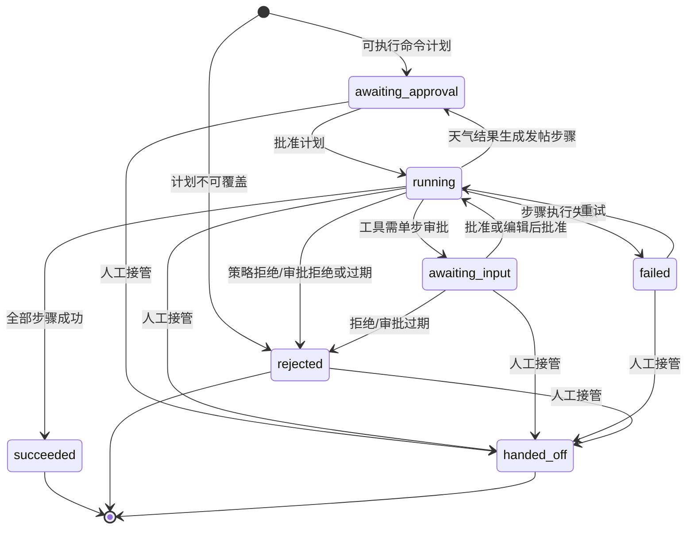
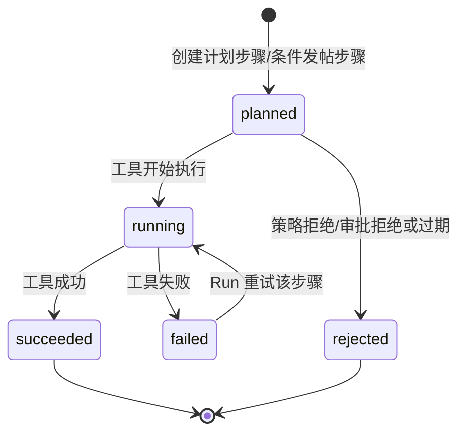
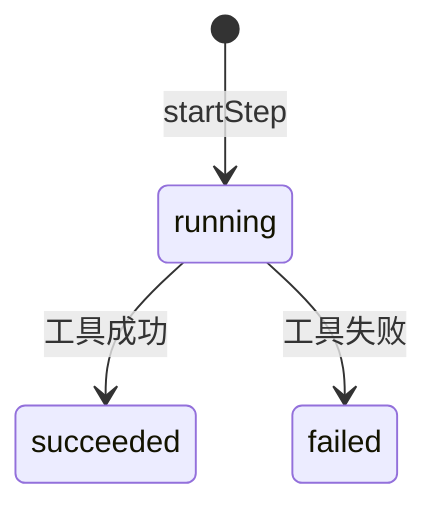
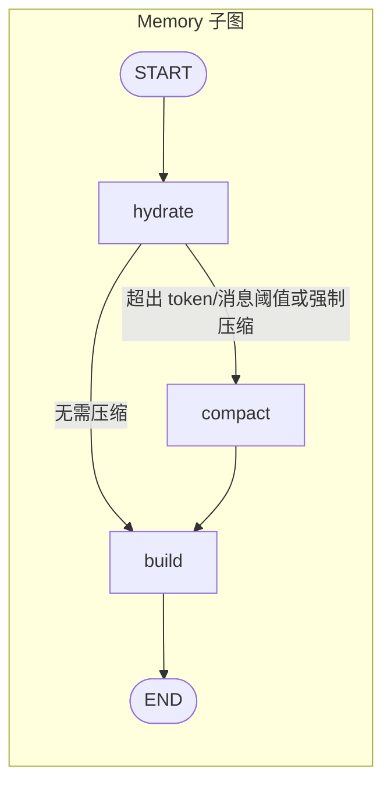
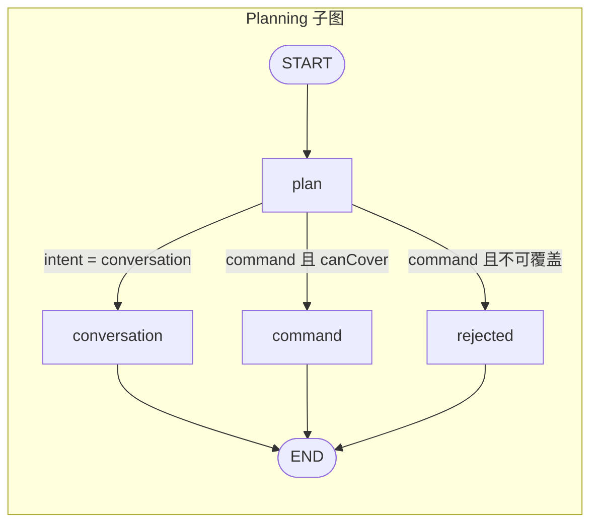
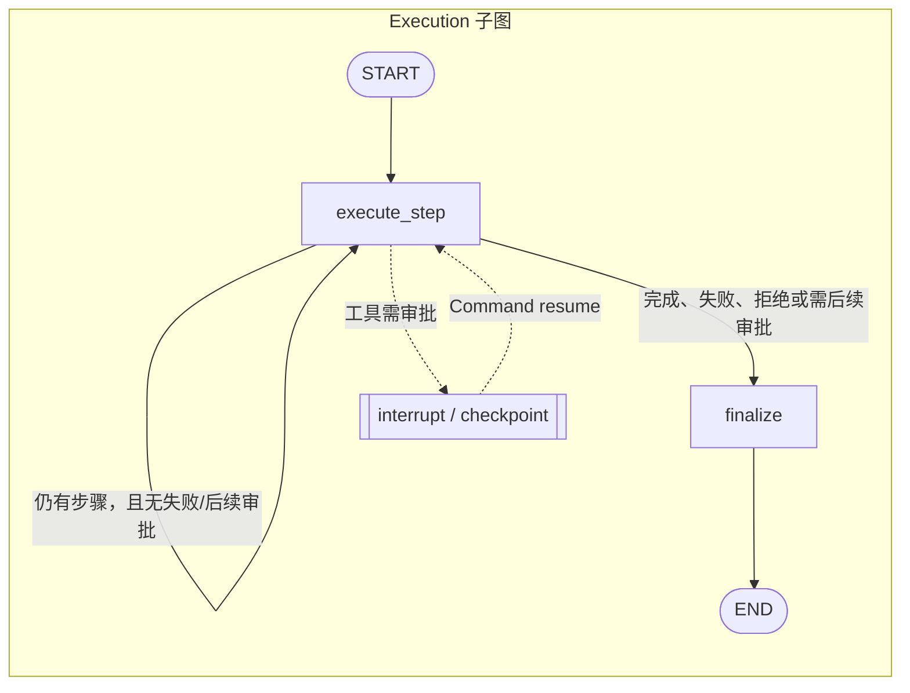
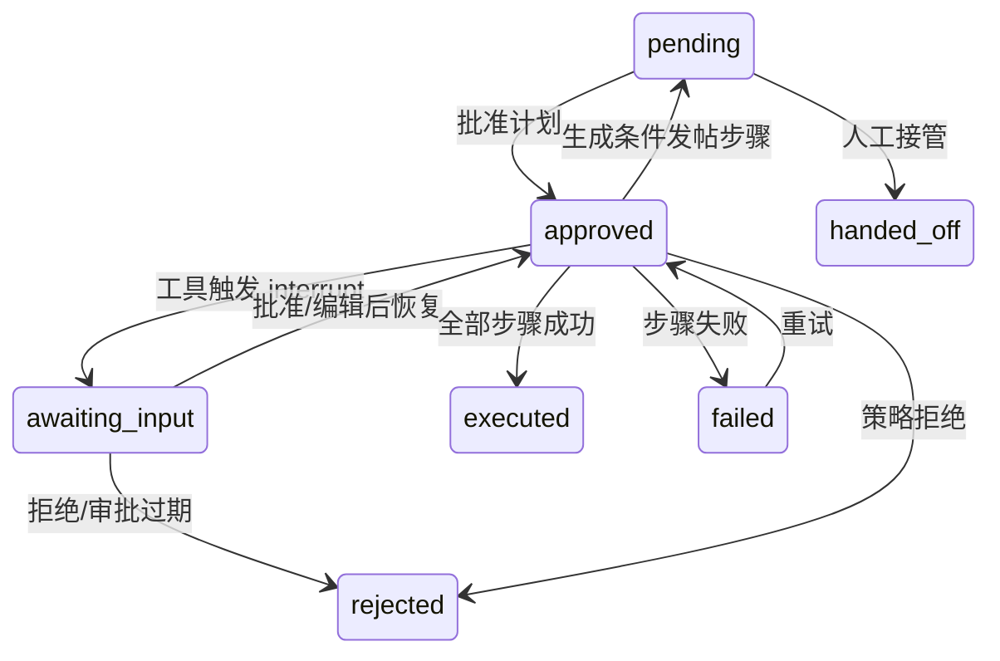
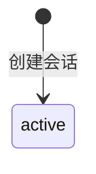

# Agent 状态转移

## 1. Workflow（持久化业务状态）

### 1.1 WorkflowRun

> `handed_off` 在路由实现中仅禁止从消息状态 `executed` 进入；因此除成功完成外的命令 Run 均可能被人工接管。

### 1.2 WorkflowStep

`skipped` 已在模型枚举中声明，但当前实现没有写入该状态。

### 1.3 ToolCall

## 2. Agent（图流程与消息投影）

### 2.1 子图区域：Memory Graph

### 2.2 子图区域：Planning Graph

规划结果对应的 `AgentMessage.planner.approvalStatus`：

| 规划结果     | 状态           |
| ------------ | -------------- |
| 对话         | `not_required` |
| 可执行命令   | `pending`      |
| 不可覆盖命令 | `rejected`     |

### 2.3 子图区域：Execution Graph

消息投影状态转移：

人工接管时，仅 `pending --> handed_off` 会同步消息投影；其他非 `executed` 状态可将 Run 转为 `handed_off`，但消息投影保持原值。

### 2.4 AgentSession

`archived` 已在模型枚举中声明，但当前实现没有状态转移；删除会话是记录删除，不是状态转换。

## 3. 幂等边界

- 必须幂等：`post.publish` 等有外部副作用的写工具。
- 当前键：`runId:stepId`；帖子表以 `agentIdempotencyKey` 唯一索引去重。
- 当前缺口：检查点、Run/Step/Approval/Event 的多次落库与外部副作用不在同一事务中；除发帖外的新写工具也必须显式实现该键。
