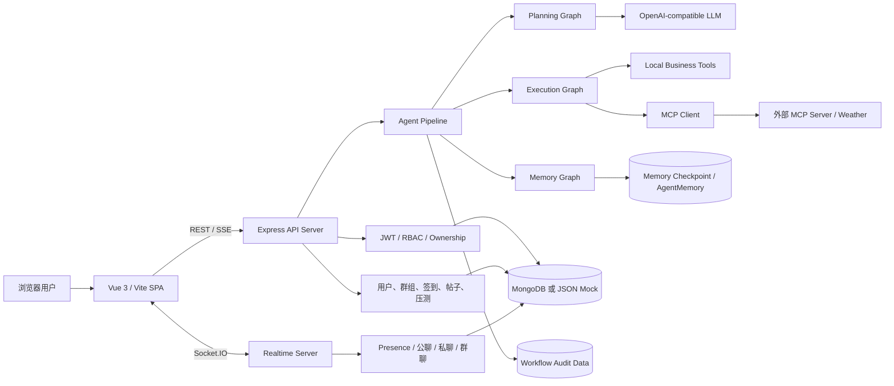
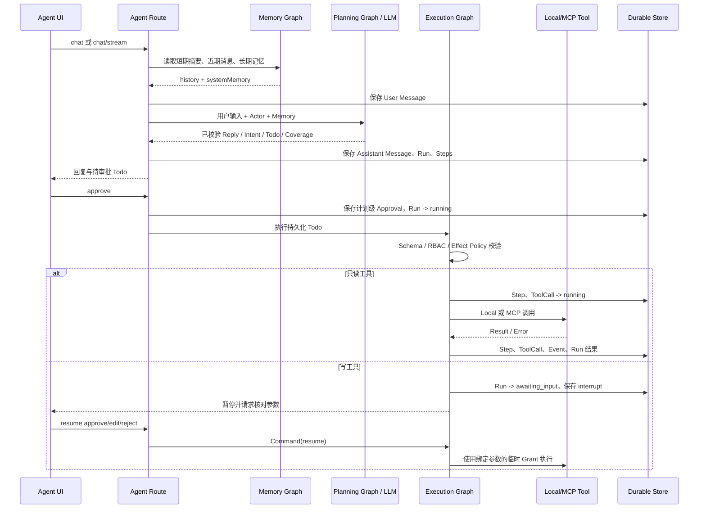
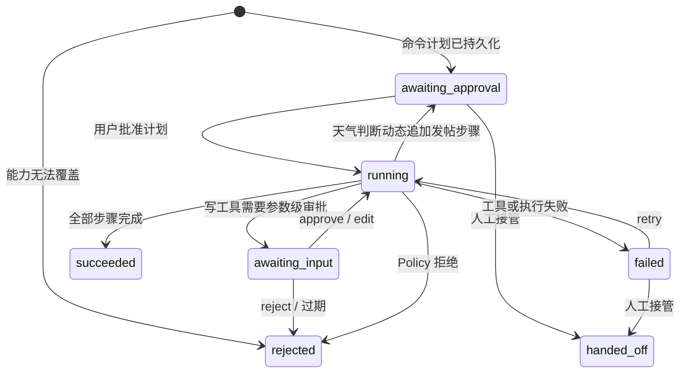

# FSE Chatroom 系统交接文档

> 本文基于当前仓库实现整理。系统由 Vue 前端和 Node.js 后端组成；当前没有独立部署的 `pipeline` 服务，Agent Pipeline 运行在 Backend Server 进程内。

## 1. 系统架构与数据流

### 1.1 总体架构



### 1.2 前端组件

| 组件                 | 职责                                                                                  |
| -------------------- | ------------------------------------------------------------------------------------- |
| `App.vue`            | 登录、联系人、公共/私聊/群聊、帖子、签到、管理员压测入口                              |
| `AgentChat.vue`      | Agent 会话、计划审批、危险工具 interrupt 处理、失败重试、人工接管、链路监控和批量测试 |
| `services/api.js`    | REST、SSE 流式 Agent 响应、监控和测试 API 客户端                                      |
| `services/socket.js` | Socket.IO 连接、鉴权和带 ACK 的事件调用                                               |
| `style.css`          | 主应用、Agent 对话和监控面板样式                                                      |

### 1.3 Backend Server 组件

| 层级     | 主要组件                                                                |
| -------- | ----------------------------------------------------------------------- |
| 启动层   | `server.js`：加载 Prompt、连接存储、创建 HTTP/HTTPS 与 Socket.IO Server |
| HTTP 层  | `app.js`：CORS、JSON、Rate Limit、健康检查、路由和统一错误处理          |
| API 路由 | Auth、Users、Groups、Posts、Checkins、Stress、Agent                     |
| 实时层   | Socket.IO Presence、Room 鉴权、历史读取、消息持久化和广播               |
| Agent 层 | Session、Memory、Planner、Policy、Workflow、Evaluation、Monitor         |
| Tool 层  | Local Tools、MCP Tool Adapter、MCP Streamable HTTP Client               |
| 数据层   | Mongoose Models；`DB_DRIVER=json` 时切换到同接口 JSON Model             |

### 1.4 Agent Pipeline 数据流



聊天业务与 Agent Pipeline 相互独立：普通聊天主要走 Socket.IO；Agent 对话、审批和审计走 REST/SSE。Agent 执行 `post.publish` 后会复用业务实体并广播 `post:created`。

## 2. 权限、能力与协作边界

### 2.1 权限控制边界

- REST 使用 Bearer JWT；每次请求重新读取用户并检查 `active`，不能只信任 Token 内角色。
- 角色为 `user / dispatcher / admin`。用户列表允许 `admin、dispatcher`；角色、启停用户、创建或删除签到任务等管理操作要求 `admin`。
- Agent Session、Message、Run 均以 `userId` 做所有权校验；用户不能审批、恢复、删除或读取他人的 Agent 数据。
- Socket.IO 在握手阶段校验 JWT；私聊要求双方存在 accepted Relationship，群聊要求当前用户属于群成员。
- 消息发送者身份由服务端写入，客户端不能声明或覆盖 sender。
- 全局 API 限流为每分钟 120 次；内部压测使用进程启动时生成的随机 Token 绕过限流。

### 2.2 Agent 能力边界

Agent 不是通用代码执行器。模型只能生成能力清单内的结构化 Action：

| Action                   | 类型       | 功能                       | 附加边界                                 |
| ------------------------ | ---------- | -------------------------- | ---------------------------------------- |
| `checkin.list_absentees` | read       | 查询指定签到任务未签到人员 | 任务 ID 必须存在                         |
| `post.draft`             | read       | 生成协作帖子草稿           | 不写库、不广播                           |
| `post.publish`           | write      | 创建帖子并广播             | 仅 admin；计划审批后仍需单工具审批       |
| `status.summarize`       | read       | 汇总任务和近期帖子         | 仅返回聚合信息                           |
| `mcp.weather.forecast`   | read / MCP | 查询未来 1–72 小时天气     | MCP 必须配置；坐标和小时数受 Schema 限制 |

能力边界由四层共同保证：Prompt Manifest → JSON Schema/Ajv → RBAC 与 Tool Policy → 运行时 Tool Registry。启动时会校验 Capability、Tool Contract 和 JS Handler 三者完全一致；模型不能新增工具、降低风险等级或直接访问数据库/MCP。

### 2.3 Workflow 与 Agent 的工作分工

- Agent/LLM 负责理解请求、回答问题、生成 Todo 和条件判断建议。
- Workflow 负责顺序执行、持久化状态、审批、重试、恢复、错误分类和审计。
- Express Route 负责身份、资源所有权、HTTP/SSE 生命周期以及启动执行。
- Tool Policy 负责确定 `allow / require_approval / deny`；人工只能批准可批准的写操作，不能覆盖 RBAC 或硬拒绝。
- Tool Handler 才能接触业务 Model 或外部 MCP；LLM 不持有这些对象。

## 3. State 转移、子图与 Interrupt 恢复

### 3.1 子图设计

系统使用三个 LangGraph 图：

```text
Memory Graph:   START -> hydrate -> [compact -> build | build] -> END
Planning Graph: START -> plan -> [conversation | command | rejected] -> END
Execution Graph: START -> execute_step -> [execute_step | finalize] -> END
```

- Memory Graph 将新消息幂等合并进短期窗口，超过消息数或 Token 阈值后增量压缩，再组装 `history + systemMemory`。
- Planning Graph 没有业务副作用；模型结果通过结构和权限校验后，路由到普通对话、可执行命令或拒绝。
- Execution Graph 每次只处理一个持久化 Step；成功后循环，出现失败、拒绝或新增审批点时进入 finalize。
- Graph State 字段使用 last-write-wins；节点仅返回自己更新的局部字段。函数、Socket.IO 等不可序列化运行时对象放在进程内 `executionRuntime`，不写入 Checkpoint。

### 3.2 核心状态转移



Step 状态为 `planned -> running -> succeeded/failed`，或在调用前转为 `rejected`。ToolCall 状态为 `running -> succeeded/failed`。`skipped` 已在 Schema 中保留，但当前执行器不会写入。

### 3.3 Interrupt 与恢复

1. 执行写工具前先生成包含 `runId、stepId、action、digest、expiresAt` 的审批请求。
2. `requestHumanInput` 先把 Run 和 Message 写成 `awaiting_input`，然后 LangGraph `interrupt(payload)` 暂停。
3. Graph Checkpoint 使用 `workflow:{userId}:{runId}` 隔离并落盘，HTTP 请求可以结束。
4. `/resume` 校验会话所有权、Run 状态和 interrupt ID，再通过 `Command({ resume })` 恢复原节点。
5. `approve` 使用原参数；`edit` 当前只允许修改 `post.publish.content`；`reject` 直接终止且不创建 ToolCall。
6. 恢复后重新执行 Schema、RBAC 和 Policy 校验，并签发只绑定当前 actor/run/step/action digest 的短时 Grant，防止参数被替换。
7. 无 pending interrupt 或 interrupt ID 已过期/不匹配时返回冲突，不会从头重放流程。

失败重试不是恢复 interrupt：`retry` 将 failed Run 切回 running，执行器跳过 Message 中已标记 `executed` 的步骤，从首个未成功步骤继续。写工具使用稳定的 `runId:stepId` 幂等键。

## 4. 落库策略

### 4.1 业务和会话实体

| 实体           | 写入时机                                                         |
| -------------- | ---------------------------------------------------------------- |
| `User`         | 注册、角色或启用状态变更                                         |
| `Relationship` | 新用户加入时建立默认关系                                         |
| `ChatGroup`    | 创建群组                                                         |
| `ChatMessage`  | Socket `chat:send` 校验通过后、广播之前                          |
| `Post`         | REST 发帖或 Agent `post.publish` 成功时；Agent 写入幂等键        |
| `UserCheckin`  | 管理员创建任务、用户签到、管理员删除                             |
| `SpeedTestRun` | 创建压测任务、运行中和完成/失败结果                              |
| `AgentSession` | 新会话创建；每次消息更新标题和活跃时间                           |
| `AgentMessage` | 用户输入、模型回答与计划落库；审批/执行进度同步更新 planner 投影 |
| `AgentMemory`  | 用户明确要求“记住”时保存跨 Session 长期事实                      |

### 4.2 Workflow 审计实体

| 实体            | 写入时机                                                             |
| --------------- | -------------------------------------------------------------------- |
| `WorkflowRun`   | 命令计划生成后立即创建；审批、等待输入、成功、失败、拒绝、接管时更新 |
| `WorkflowStep`  | 每个 Todo 创建一条；开始、完成、失败、拒绝或编辑参数时更新           |
| `Approval`      | 计划批准、工具批准/拒绝、人工接管时追加，不覆盖旧记录                |
| `ToolCall`      | 真正分发工具前创建 running；返回后写结果、错误、耗时                 |
| `WorkflowEvent` | Run 创建、审批、工具开始/结束、等待输入、重试和终态时追加            |

重要顺序是：先持久化执行意图和 running 证据，再调用 Tool，最后写回结果。当前尚未使用数据库事务/outbox，因此“外部副作用成功但结果尚未落库时进程崩溃”仍是需要生产化加强的窗口；`post.publish` 已用幂等键降低重复写风险。

### 4.3 Memory 与 Checkpoint

- `AgentMessage` 是 UI 与审计的原始事实源；Memory 是可重建的派生投影。
- 短期记忆保存滚动摘要、近期原文窗口和统计；首次访问旧会话时才扫描 Message 重建。
- 长期记忆只记录用户明确要求保存的事实，按用户范围检索。
- Memory Checkpoint 与 Workflow Checkpoint 使用不同文件和 thread ID，生命周期互不影响。
- Memory 更新失败不会推翻已经成功的聊天响应：系统删除失效投影，下轮从 Message 重建。

### 4.4 MongoDB 与 JSON Mock

- 默认生产路径为 Mongoose + MongoDB；`DB_DRIVER=json` 切换为同一 Model API 的 JSON 文件实现。
- `JSON_DATA_DIR` 保存基础社交数据；`AGENT_SESSION_DATA_DIR` 保存 Agent Session/Message；`WORKFLOW_DATA_DIR` 保存 Workflow 记录和 Checkpoint。
- JSON Model 使用临时文件写入后 rename，提供单文件原子替换；Memory/Workflow Checkpointer也采用临时文件替换。
- JSON Mock 只适合本地、单进程和测试：没有数据库事务、分布式锁或并发写 CAS，不应作为多实例生产存储。

## 5. 服务恢复与校验组件

- 启动校验：Server 启动前加载所有 Prompt；校验 JSON 可解析、Schema 可编译、Action 无重复、Capability/Tool/Handler 完全对齐、所有 write tool 必须要求确认。失败时服务不启动。
- Planner 校验：LLM 输出必须满足 Action Protocol；再校验 allowlist、参数 Schema、角色和 MCP 是否已配置。
- 执行前校验：每个 Step 再走一次 Tool Policy；写操作 resume 后再次校验并验证短时 Grant，避免 TOCTOU。
- Checkpoint 恢复：执行图按 user/run 持久化暂停状态；恢复时重新 hydrate Message 和 Run 文档，缺失即失败。
- 失败恢复：failed Run 可从失败点重试；已成功步骤不重复执行；明确接管可进入 `handed_off` 终态。
- 外部调用恢复：LLM 有超时；MCP 有连接/调用超时，只对只读且可重试的瞬时错误执行有界指数退避和 jitter，每次重试创建新 Transport。
- 会话删除：存在 running 或 awaiting_input 的工作流时拒绝删除；安全状态下级联清理 Run、Step、ToolCall、Approval、Event、Memory 和 Checkpoint。
- 监控与审计：Session Monitor 从真实 Run/Step/ToolCall/Event 聚合成功率、Token、P50/P95 和调用记录；管理员 Eval 提供整体运行指标。
- 当前生产化缺口：JSON Checkpoint 只有进程内锁；多实例需换数据库 Saver 与租约。远程工具调用仍建议增加 outbox、分布式 tracing、熔断和补偿机制。

## 6. 基础功能与可用函数

### 6.1 用户和协作功能

- 注册/登录、JWT 当前用户查询。
- 用户列表、角色和启用状态管理。
- 公共、好友私聊、群组聊天、在线状态和历史消息。
- 创建群组、发布/读取帖子。
- 创建、签到和删除签到任务。
- 管理员本机健康接口并发压测，输出吞吐及 P50/P95/P99。

### 6.2 Agent 对外接口

| 接口                                     | 功能                                       |
| ---------------------------------------- | ------------------------------------------ |
| `POST /api/agent/chat`                   | 非流式对话或规划                           |
| `POST /api/agent/chat/stream`            | SSE 流式 reply，最终返回已校验和持久化计划 |
| `GET/POST/DELETE /api/agent/sessions...` | 会话和历史生命周期                         |
| `POST .../approve`                       | 批准顶层计划并进入执行图                   |
| `POST .../runs/:runId/resume`            | 恢复 LangGraph interrupt                   |
| `POST .../runs/:runId/retry`             | 从失败步骤重试                             |
| `POST .../handoff`                       | 明确登记人工接管                           |
| `GET /api/agent/runs/:runId`             | 查询完整审计链路                           |
| `GET .../monitor`                        | 当前会话链路及聚合指标                     |
| `POST /api/agent/monitor/tests`          | 最多 10 条隔离测试；仅自动执行只读工具     |
| `GET /api/agent/evals/summary`           | 管理员 Agent 运行指标                      |

### 6.3 关键内部函数边界

- Memory：`prepareMemoryContext`、`commitMemoryMessagesBestEffort`、`withSessionMemory`。
- Planning：`planAgentWorkflow`、`planAgentWorkflowStream`、`validatePlan`。
- Execution：`executeApprovedAgentWorkflow`、`resumeAgentWorkflow`。
- Workflow Persistence：`createRun`、`approveRun`、`startStep`、`completeStep`、`finishRun`、`retryRun`、`getRunDetail`。
- Policy：`assessToolCall`、`authorizeToolExecution`、`issueApprovalGrant`。
- Tools：`executeAgentAction` 统一分发到 Local `execute` 或 MCP `executeActions`。
- Observability：`getSessionMonitor`、`loadRunTrace`、`evaluateAgentMessages`。

### 6.4 MCP

当前外部能力只有 Weather MCP：

```text
mcp.weather.forecast
  -> route(server=weather, tool=MCP_WEATHER_TOOL)
  -> 内部参数 {latitude, longitude, hours}
  -> MCP 参数 {latitude, longitude, forecast_days, hourly_variables}
  -> Streamable HTTP + 可选 Bearer Token
  -> 结果按 requested hours 截断并规范化
```

配置项主要为 `MCP_WEATHER_URL`、`MCP_WEATHER_TOKEN`、`MCP_WEATHER_TOOL`、连接/调用超时、只读重试次数和退避间隔。新增 MCP Action 时必须同步 Capability Manifest、Tool Contract、MCP Route 和 Handler，否则启动校验会失败。

## 7. 测试架构

| 测试层             | 设计关注点                                                                                                               |
| ------------------ | ------------------------------------------------------------------------------------------------------------------------ |
| Unit               | Planner 协议和 Schema、能力同步、RBAC、Tool Policy、Grant 绑定、Local/MCP 参数适配、超时重试、幂等写、天气判断、监控聚合 |
| Workflow           | Planning/Execution Graph 路由，多步执行，危险工具 interrupt/resume/edit/reject，失败分类与重试                           |
| Integration API    | 登录与角色权限、Session 所有权、聊天持久化、审批后执行、完整审计图、会话删除和 SSE 契约                                  |
| Integration Socket | 握手鉴权、公共/私聊 Room、关系边界、消息落库和广播身份                                                                   |
| Context            | Memory 落盘、Checkpoint 原子性、窗口压缩、事实保留、压缩率和旧会话迁移                                                   |
| Agent Eval         | Intent/Coverage、工具选择 Precision/Recall/F1、参数精确匹配、安全拒绝、Token 和延迟预算、Trace 完整性                    |
| Performance        | API/Socket 并发、吞吐、P50/P95/P99、成功率和消息交付率                                                                   |

常用命令：

```bash
cd backend
npm test                 # Unit + API/Socket Integration
npm run test:context     # Memory / Context
npm run test:agent-eval  # 确定性 Agent Eval
npm run eval:agent       # 有调用预算的真实模型评估
npm run test:performance # 性能基准
npm run verify           # 生成验证报告

cd ../frontend
npm run build            # 前端生产构建校验
```

测试原则是分离三类结论：确定性 CI 验证契约和安全边界；固定 Eval 集检测模型/Prompt 回归；生产监控衡量真实链路。HTTP 200、规划成功、工具成功和业务目标成功不能混为同一个指标。

## 8. 交接注意事项

- 本地一键启动使用根目录 `./dev.sh`，当前脚本以 JSON Mock 和本地 HTTPS 启动前后端。
- 生产必须配置 MongoDB、JWT Secret、LLM、CORS/TLS；启用天气能力时配置 MCP。
- Prompt Markdown 中包含机器可读契约，属于运行时代码的一部分，变更需同时更新对应测试。
- 排查 Agent 问题优先按 `sessionId -> runId -> stepId -> toolCallId/event` 追踪，不要只看最终回复。
- 对未完成流程不要直接改数据库状态；优先使用 resume、retry 或 handoff，保持审计链完整。
